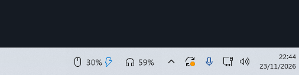

# BatteryTray

Mostra a bateria dos aparelhos sem fio numa faixa da barra de tarefas do Windows, ao lado da área de notificação (um ícone do aparelho + porcentagem, com raio azul quando está carregando).



**[Baixar o BatteryTray.exe](https://github.com/marcosniciu/BatteryTray/releases/latest)**: um arquivo só, não precisa instalar nada.

## Aparelhos suportados

| Aparelho | Como lê |
|---|---|
| Redragon M719 Invader Pro (receptor 25A7:FA7E) | Protocolo HID do software oficial: consulta `08 04`, nível 0..10 no byte 6, byte 7 = carregando |
| HyperX Cloud Stinger Core Wireless (03F0:0A93) | Feature report FF, tensão em mV convertida para % |
| JBL Quantum 910 (receptor 0ECB:2088) | Escuta o input report `08` que o fone envia (não testado) |
| Controles Bluetooth e outros | Bateria que o próprio Windows informa (`DEVPKEY_Device_BatteryLevel`) |

O app só envia consultas de leitura; nenhuma configuração é gravada nos aparelhos.

## Uso

- Clique direito na faixa: lista os aparelhos, "Iniciar com o Windows", "Atualizar agora", "Sair".
- Menu "Gerar diagnóstico" (ou `BatteryTray.exe --dump`): escuta 20 s, grava `batterytray-dump.txt` ao lado do .exe (diagnóstico).
- `BatteryTray.exe --startup on|off`: liga/desliga o início com o Windows.

## Compilar

Requer o .NET 10 SDK.

```powershell
dotnet publish BatteryTray -c Release -r win-x64 --self-contained true -p:PublishSingleFile=true -p:EnableCompressionInSingleFile=true -o dist
```

Gera um único `dist\BatteryTray.exe` que roda sem instalar nada.

`StingerProbe/` contém as ferramentas de teste usadas para descobrir os protocolos.
